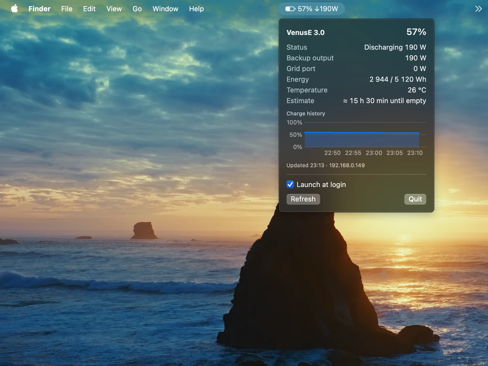

# MarstekBar — Marstek Venus E battery monitor for the macOS menu bar

[](https://github.com/ponomarenko/marstek-bar/actions/workflows/build.yml)
[](LICENSE)


MarstekBar is a small native macOS menu bar app that shows the live state of a
**Marstek Venus E 3.0** home battery: charge level, charging or discharging power,
remaining energy and a 24-hour history. It talks to the battery directly over the
**Marstek Local Open API** (JSON over UDP), so it needs no cloud account, no Home
Assistant and no internet connection.



## Features

- **Charge level in the menu bar**, with the power flow next to it:
  `78% ↑350W` while charging, `78% ↓350W` while discharging.
- **Details on click**: status, backup output and grid port power, remaining and
  rated energy, temperature, and an estimate of the time until empty or full.
- **24-hour charge history** that survives restarts.
- **Low-battery notification** when the charge drops to 20% while discharging.
- **Automatic discovery** of the battery on the local network. The address is cached
  and found again if it changes.
- **Gentle polling**, once a minute, because the device API is fragile.
- **Read-only**: the app never changes the battery mode or settings.
- **English and Ukrainian** interface, following the system language.
- No dependencies: a few hundred lines of Swift and SwiftUI.

## Requirements

- macOS 13 or later
- A Swift toolchain (Xcode Command Line Tools are enough)
- A Marstek Venus E 3.0 on the same local network as the Mac
- Open API enabled on the battery, on the default port 30000

Tested on a Venus E 3.0 with firmware 151. Other Marstek models that support the
Local Open API (Venus A, C, D) may work but are untested.

## Enable the Open API on the battery

1. Open the Marstek mobile app and select the battery.
2. Go to the device settings and turn on **Open API**.
3. Keep the port at **30000**.

## Install

There are no prebuilt releases yet, so build the app from source:

```sh
git clone https://github.com/ponomarenko/marstek-bar.git
cd marstek-bar
./scripts/build-app.sh
open build/MarstekBar.app
```

On first launch macOS asks for **Local Network** access. Allow it, otherwise the app
cannot reach the battery. To keep the app, move `build/MarstekBar.app` to
`/Applications` and turn on **Launch at login** in its menu.

## How it works

- The battery is discovered with a `Marstek.GetDevice` UDP broadcast. Its IP address
  is cached and rediscovered automatically after three failed polls.
- Every 60 seconds the app sends `ES.GetMode`. `Bat.GetStatus` (energy and
  temperature) follows only on every fifth poll, so those two values can lag by up
  to five minutes.
- Net battery power is `ongrid_power + offgrid_power`. Positive means discharging.
- If no fresh data arrives for three minutes, the icon turns into a warning sign and
  the last known value stays visible.
- History is stored in `~/Library/Application Support/MarstekBar/history.json`.

## Troubleshooting

| Problem | What to check |
|---|---|
| "Battery not found on the network" | Open API is enabled in the Marstek app, and the Mac and the battery are on the same network and subnet. |
| "No access to the local network" | System Settings → Privacy & Security → Local Network → enable MarstekBar. |
| Warning icon and stale data | The battery stopped answering. The Local API on some firmware switches itself off; turn Open API off and on again in the Marstek app. |
| Values jump or go missing | Only one program should poll the battery. Quit other copies of MarstekBar and pause other Local API integrations. |

## Known limitations

- The operating mode is not shown. Firmware 151 reports `Manual` over the Local API
  even when the Marstek app is set to UPS, so the value cannot be trusted.
- Load on the backup output counts as discharge. If the battery passes grid power
  through to that output, the arrow and the time estimate may be wrong.
- The low-battery threshold (20%) and the polling interval are fixed in the code.

## FAQ

**Does it need the Marstek cloud or an account?**
No. The app talks only to the battery, over the local network.

**Can it switch modes or start charging?**
No. MarstekBar only reads data.

**Does it work with Home Assistant running at the same time?**
It can, but the Local API is unstable under load. If values freeze, lower the polling
rate of the other integration.

## Related projects

- [taurgis/has-marstek-local-api](https://github.com/taurgis/has-marstek-local-api) — Home Assistant integration, Local API
- [jaapp/ha-marstek-local-api](https://github.com/jaapp/ha-marstek-local-api) — Home Assistant integration, Local API
- [ViperRNMC/marstek_venus_modbus](https://github.com/ViperRNMC/marstek_venus_modbus) — Home Assistant integration, Modbus

## Support and contributing

- Found a bug or have a question? [Open an issue](https://github.com/ponomarenko/marstek-bar/issues/new/choose).
  Please include the battery model, firmware version and macOS version.
- Pull requests are welcome. See [CONTRIBUTING.md](CONTRIBUTING.md).
- To report a security problem, see [SECURITY.md](SECURITY.md).

## License

[MIT](LICENSE). MarstekBar is an independent project and is not affiliated with or
endorsed by Marstek.
